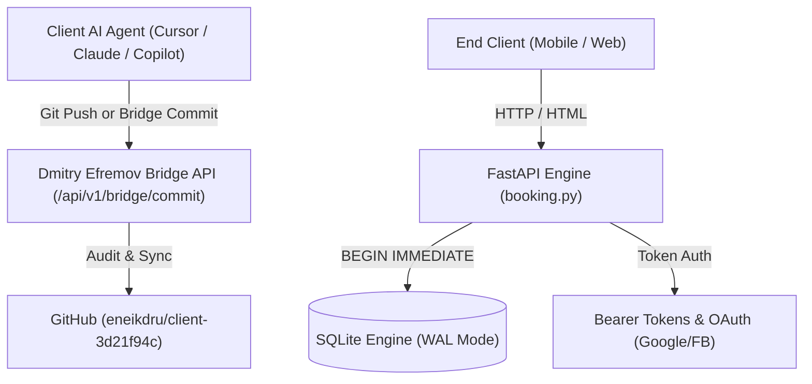

# ARCHITECTURE.md — System Architecture & Data Model

This document outlines the architecture, data structures, and state transitions of the Client 3D21F94C Booking Engine.

---

## 1. High-Level Architecture



---

## 2. Database Schema (SQLite)

### `users`
* `user_id`: TEXT PRIMARY KEY

### `tokens`
* `token_hash`: TEXT PRIMARY KEY (SHA-256 of personal agent bearer token)
* `user_id`: TEXT NOT NULL, REFERENCES users(user_id)
* `expires_at`: INTEGER NOT NULL (UNIX epoch timestamp)

### `masters`
* `master_id`: TEXT PRIMARY KEY
* `name`: TEXT NOT NULL

### `services`
* `service_id`: TEXT PRIMARY KEY
* `master_id`: TEXT NOT NULL, REFERENCES masters(master_id)
* `name`: TEXT NOT NULL
* `duration_seconds`: INTEGER NOT NULL
* `buffer_seconds`: INTEGER NOT NULL

### `availability`
* `master_id`: TEXT NOT NULL, REFERENCES masters(master_id)
* `start_timestamp`: INTEGER NOT NULL
* `end_timestamp`: INTEGER NOT NULL

### `bookings`
* `booking_id`: TEXT PRIMARY KEY
* `user_id`: TEXT NOT NULL, REFERENCES users(user_id)
* `master_id`: TEXT NOT NULL, REFERENCES masters(master_id)
* `service_id`: TEXT NOT NULL, REFERENCES services(service_id)
* `start_timestamp`: INTEGER NOT NULL
* `end_timestamp`: INTEGER NOT NULL (start + duration + buffer)
* `created_at`: INTEGER NOT NULL
* `status`: TEXT NOT NULL ('CONFIRMED', 'CANCELLED')

---

## 3. Concurrency & Transaction Model
To eliminate race conditions when multiple users book the same slot simultaneously:
1. SQLite connection is opened in write mode with `BEGIN IMMEDIATE`.
2. Master availability windows are queried for the specified timestamp.
3. Overlap check query executes:
   ```sql
   SELECT 1 FROM bookings 
   WHERE master_id = ? 
     AND status = 'CONFIRMED'
     AND NOT (end_timestamp <= ? OR start_timestamp >= ?)
   ```
4. If an overlap exists, transaction aborts with HTTP 409 Conflict.
5. If free, reservation is inserted and committed atomically.
